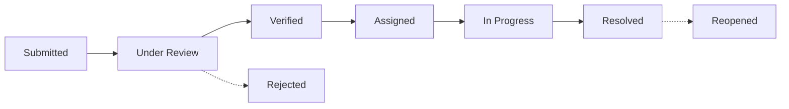

# MoveSmart — Smart Mobility Platform (Mumbai Metropolitan Region)

> **Smarter streets. Better journeys.**  
> An enterprise-grade civic mobility platform connecting Mumbai commuters directly with municipal traffic operations and ward maintenance units.

---

## 1. Executive Overview

**MoveSmart** bridges civic reporting and smart-city operations across the **Mumbai Metropolitan Region (MMR)**. It pairs an accessible citizen engagement portal with a high-performance operations command center, powered by real-time spatial geofencing, photographic evidence verification, and multi-user Role-Based Access Control (RBAC).

### Key Highlights
- **Public Transparency & Citizen Portal:** Public landing page, real-time geocoded hazard map, 4-step hazard submission wizard, GPS pin dropping, persistent multipart photo evidence upload, and unique tracking ID generation (`MS-TRK-XXXXX`).
- **Zero-Trust Multi-User RBAC:** Clear privilege separation across three distinct roles: `CITIZEN`, `OPERATIONS`, and `ADMIN`. Passwords hashed with BCrypt. Stateless JWT authentication stored in memory and `sessionStorage` (strictly eliminating sensitive tokens from `localStorage`).
- **Dedicated Operations Center:** Live incident queue, 8-status lifecycle stepper, priority action queue, CCTV cross-verification desk, municipal squad assignment, and real-time response analytics.
- **Enterprise Administrator Suite:** Staff user provisioning, account activation/deactivation, audit trail stream, system architecture telemetry, and live backend health probes (`/api/health`).
- **Resilient Full-Stack Architecture:** Spring Boot 4 REST API with Spring Data JPA persistence. Automatic dual-mode database support: zero-config embedded H2 for instant local evaluation, and production-ready PostgreSQL (`postgresql-x64-18` compatible).

---

## 2. Technology Stack

### Frontend Client
- **Framework:** React 19 + TypeScript
- **Build Tool:** Vite 7 (ESM)
- **Styling:** Tailwind CSS v4
- **Spatial GIS Mapping:** Leaflet 1.9 + React-Leaflet (OpenStreetMap with CartoDB Voyager CDN fallback)
- **Analytics & Visualizations:** Recharts
- **Iconography:** Lucide React
- **Session Security:** In-Memory Cache + `sessionStorage` (No persistent `localStorage` tokens)

### Backend Service (`movesmart-backend`)
- **Platform:** Java 21 / 23 (OpenJDK)
- **Framework:** Spring Boot 4.1.2 (Spring MVC + Spring Data JPA + Spring Security)
- **Security:** Spring Security 6, BCrypt Password Encoder, JJWT 0.12.6 (HMAC-SHA256)
- **Databases Supported:**
  - **Embedded (Default):** H2 In-Memory Database (`jdbc:h2:mem:movesmartdb`) with pre-seeded MMR baseline dataset
  - **Production:** PostgreSQL / PostGIS (`org.postgresql:postgresql`)
- **File Storage:** Persistent multipart evidence store in normalized `uploads/` directory with Spring MVC static resource handler (`/uploads/**`)
- **Validation:** Jakarta Bean Validation (`@Valid`, `@NotBlank`, `@Size`, `@Email`)

---

## 3. User Roles & Permissions Matrix

| Capability | Public / Guest | Citizen (`ROLE_CITIZEN`) | Operations Staff (`ROLE_OPERATIONS`) | Administrator (`ROLE_ADMIN`) |
| :--- | :---: | :---: | :---: | :---: |
| View Public MMR Map & Telemetry | ✓ | ✓ | ✓ | ✓ |
| Track Complaint by ID (`MS-TRK-...`) | ✓ (PII Redacted) | ✓ (Own PII Unmasked) | ✓ (Full Details) | ✓ (Full Details) |
| Register Account | ✓ (`ROLE_CITIZEN` Only) | — | — | — |
| Submit Hazard with Photo & GPS | ✕ | ✓ | ✓ | ✓ |
| View Personal Reports (`/my-reports`) | ✕ | ✓ (Strictly Own Reports) | ✓ | ✓ |
| Receive In-App Notifications | ✕ | ✓ | ✓ | ✓ |
| Update Profile & Change Password | ✕ | ✓ | ✓ | ✓ |
| Access Operations Center | ✕ | ✕ (HTTP 403 Forbidden) | ✓ | ✓ |
| Update Incident Status & Triage Notes | ✕ | ✕ | ✓ | ✓ |
| Assign Municipal Response Unit | ✕ | ✕ | ✓ | ✓ |
| Manage Staff & Users (`/api/auth/users`) | ✕ | ✕ (HTTP 403 Forbidden) | ✕ (HTTP 403 Forbidden) | ✓ |
| Create Staff / Admin Accounts | ✕ | ✕ | ✕ | ✓ |
| Deactivate / Reactivate Accounts | ✕ | ✕ | ✕ | ✓ |
| Reset Demonstration Dataset | ✕ | ✕ | ✓ | ✓ |

---

## 4. 8-Status Complaint Lifecycle

Every submitted hazard transitions through structured municipal verification:



1. **Submitted:** Complaint received and logged in operations queue.
2. **Under Review:** Traffic desk evaluating location, severity, and photo evidence.
3. **Verified:** Hazard confirmed via CCTV, radar, or traffic patrol.
4. **Assigned:** Dispatched to municipal response unit (e.g., BMC Ward dewatering squad, towing crane).
5. **In Progress:** Work actively underway on site with public progress updates.
6. **Resolved:** Hazard cleared, road movement restored, and timestamped.
7. **Rejected:** Evaluated and closed (duplicate report, private property issue, or unverified hazard).
8. **Reopened:** Case reopened for recurring hazards or follow-up inspection.

---

## 5. Reportable Urban Hazard Categories

1. **Pothole:** Deep craters, asphalt cave-ins, and uneven road surface depressions.
2. **Road Damage:** Cracked road surfaces, sunken asphalt, broken paver blocks, and curb damage.
3. **Accident:** Vehicular collisions, overturned trucks, and crash debris blockages.
4. **Waterlogging:** Monsoon flash pooling, flooded underpasses, and subway inundation.
5. **Traffic Signal Failure:** Blacked-out signal lights, broken timers, and conflicting phase indicators.
6. **Road Blockage:** Stalled heavy transport, construction debris, and illegal traffic barriers.
7. **Fallen Tree:** Uprooted monsoon trees, fallen branches, and damaged utility cables.
8. **Other Road Hazard:** Uncovered manholes, oil/chemical spills, and missing safety barriers.

---

## 6. Project Architecture

```
smart-mobility/
├── backend/                               # Spring Boot 4 REST API
│   ├── src/main/java/com/movesmart/movesmart_backend/
│   │   ├── config/                        # DataSeeder, WebConfig, CORS
│   │   ├── controller/                    # Auth, Incident, Notification, Activity, Health
│   │   ├── dto/                           # Request/Response validation DTOs
│   │   ├── model/                         # JPA Entities: User, Incident, Notification, ActivityLog
│   │   ├── repository/                    # Spring Data JPA Repositories
│   │   ├── security/                      # JWT Filter, JwtUtil, SecurityConfig (RBAC)
│   │   └── service/                       # Business logic services
│   ├── src/main/resources/
│   │   └── application.properties         # Zero-config H2 / PostgreSQL configuration
│   ├── uploads/                           # Persistent multipart file evidence storage
│   └── pom.xml                            # Maven dependencies
├── src/                                   # React 19 + TypeScript Client
│   ├── components/                        # MumbaiMap, Navbar, Badges, Toast, ConfirmDialog
│   ├── context/                           # AuthContext, IncidentContext
│   ├── data/                              # Mumbai location hotspots & baseline seed data
│   ├── features/
│   │   ├── admin/                         # Overview, IncidentManagement, LiveMap, Analytics, Activity, Settings, UserManagement
│   │   ├── auth/                          # AuthModal (Citizen login/register, admin login)
│   │   ├── citizen/                       # CitizenPortal, CitizenDashboard, MultiStepComplaintForm, ReportsList
│   │   └── public/                        # LandingPage, TrackComplaintModal
│   ├── services/                          # apiService, authService, storageService
│   ├── types/                             # TypeScript interfaces (auth, incident, notification, activity)
│   ├── App.tsx                            # Root application routing & role containers
│   └── main.tsx                           # Application entry point
├── .env.example                           # Frontend & backend environment reference
├── package.json                           # Frontend scripts & dependencies
├── test-phase2-e2e.js                     # 14-test E2E verification suite
├── test-auth-multiuser.js                 # 18-test multi-user authentication suite
├── security-audit.js                      # 10-test RBAC security audit suite
└── test-workflows.js                      # 11-test regression test suite
```

---

## 7. Local Setup & Execution Guide

### Prerequisites
- **Node.js:** v18+ (Node 20 or 22 recommended)
- **Java Platform:** JDK 21 or JDK 23
- **Maven:** v3.8+ (or use included `mvnw`)
- **Port Availability:** `8080` (Backend API) and `5173` (Vite Frontend)

---

### Step 1: Start the Spring Boot Backend

Open a terminal in the project root:

```bash
cd backend
mvn spring-boot:run
```

- Backend starts on `http://localhost:8080`.
- Automatic database initialization: Embedded H2 database (`jdbc:h2:mem:movesmartdb`) automatically populates baseline MMR incidents, users, and audit records.
- H2 Web Console accessible at `http://localhost:8080/h2-console` (JDBC URL: `jdbc:h2:mem:movesmartdb`, User: `sa`, Password: empty).
- Health check probe: `http://localhost:8080/api/health`.

#### (Optional) Running with PostgreSQL
If using PostgreSQL instead of embedded H2:
```bash
$env:DATABASE_URL="jdbc:postgresql://localhost:5432/movesmart_db"
$env:DATABASE_USERNAME="postgres"
$env:DATABASE_PASSWORD="your_postgres_password"
mvn spring-boot:run
```

---

### Step 2: Start the React Frontend

Open a second terminal in the project root:

```bash
npm install
npm run dev
```

- Open `http://localhost:5173` in your browser.
- The frontend will automatically connect to `http://localhost:8080/api` and display the live green **API 8080** indicator.

---

## 8. Pre-Configured Accounts for Local Demonstration

| Role | Email Address | Password | Intended Usage |
| :--- | :--- | :--- | :--- |
| **System Administrator** | `admin@movesmart.city` | `Admin@2026` | Full system access, user management, staff creation, incident triage |
| **Operations Controller** | `ops.admin@movesmart.city` | `Operations@2026` | Operations center queue triage, status updates, unit dispatch |
| **Citizen Commuter** | `citizen.mumbai@movesmart.city` | `Citizen@2026` | Citizen portal, filing complaints, personal dashboard, in-app alerts |

> **Note:** Any commuter can register a new, independent citizen account via the **Citizen Registration** form.

---

## 9. Comprehensive Testing & Verification

All automated test suites can be executed directly from the terminal against the running system:

### 1. Citizen Portal E2E Verification Suite (14 Tests)
```bash
node test-phase2-e2e.js
```
Verifies: Citizen registration, duplicate email rejection (HTTP 400), login, invalid password handling (HTTP 401), independent multi-user registration, RBAC barrier (`/api/auth/users` 403), 4-step complaint submission, persistent photo upload (`/uploads/`), in-app notifications, notification mark-read, strict data isolation (`/my-reports`), public tracking PII redaction, profile editing, and password changing.

### 2. Multi-User Authentication Suite (18 Tests)
```bash
node test-auth-multiuser.js
```
Verifies: Concurrent citizen registrations, token uniqueness, server-side role enforcement, incident ownership isolation, staff provisioning by admin, staff login, status update permissions, and account deactivation.

### 3. Final Security Audit Suite (10 Tests)
```bash
node security-audit.js
```
Verifies: Safe DTO sanitization on `/api/auth/users` (no password hashes or secrets returned), HTTP 403 enforcement against citizens and operations staff, role tamper resistance on registration, and entity store integrity.

### 4. Workflow Regression Suite (11 Tests)
```bash
npm test
```
Verifies: Baseline seed data, statistics calculations, submission, status workflows, editing, deletions, multi-variable filters, and audit logging.

### 5. Frontend Production Build Check
```bash
npm run build
```
Executes `tsc && vite build` ensuring 100% type safety and zero compiler warnings.

---

## 10. Emergency Notice & Disclaimer

> [!IMPORTANT]
> **MoveSmart is NOT an emergency response service.**  
> MoveSmart is an urban civic infrastructure tracking and municipal coordination platform. In the event of active traffic accidents involving personal injuries, structural collapses, fires, or medical crises, dial **112** (National Emergency), **100** (Police Control Room), or **108** (Ambulance) immediately.
